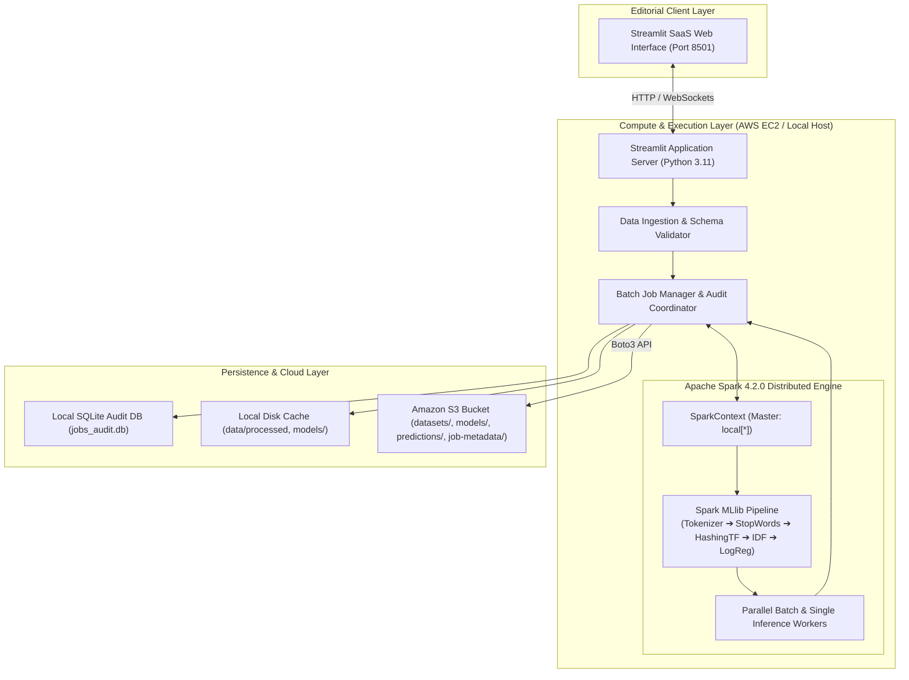
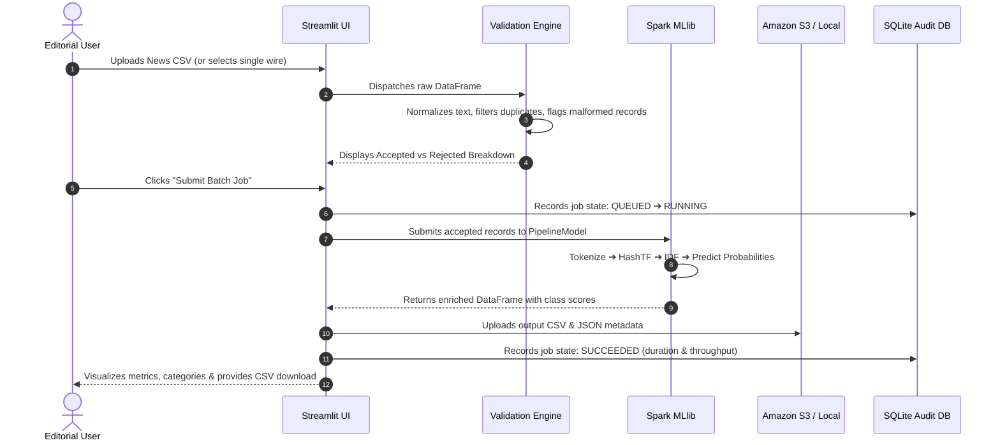

# NewsPulse AI — Architecture & Technical Specifications

NewsPulse AI is a cloud-native editorial intelligence and classification platform built for newsrooms, research desks, and media intelligence teams. It pairs distributed data processing with an editorial design system.

---

## 1. System Architecture Overview



---

## 2. Core Architectural Pillars

### A. Apache Spark & PySpark
- **Why Spark?** Traditional single-threaded NLP pipelines struggle with high-volume press archives. Apache Spark decouples feature extraction and inference across parallel partitions.
- **Spark MLlib Pipeline Architecture:**
  1. `RegexTokenizer`: Pattern-based word tokenization (`\W+`, minimum length 3, lowercase).
  2. `StopWordsRemover`: Strips common non-informative English stop words.
  3. `HashingTF`: MurmurHash3 term frequency projection into a bounded vector space ($N = 4,000$ features) to prevent memory explosion.
  4. `IDF`: Inverse Document Frequency weighting across the corpus.
  5. `LogisticRegression`: Multi-class L2-regularized multinomial logistic regression (`regParam = 0.08`, `maxIter = 30`).
- **Resource Consciousness:** Configured with `spark.driver.memory=2g`, `spark.sql.shuffle.partitions=2`, and `spark.python.worker.reuse=true`.

### B. Amazon EC2
- **Host Role:** Serves as the continuous compute environment running Ubuntu 22.04 LTS.
- **Service Management:** Managed under `systemd` (`newspulse.service`), ensuring automatic restart on crashes and proper reboot recovery without interactive SSH dependencies.
- **Security:** Inbound traffic restricted to port 8501 for application access and port 22 for administrative SSH.
- **IAM Instance Profile:** Uses AWS EC2 Instance Profile roles for S3 access, avoiding hardcoded static access keys in code or configuration files.

### C. Amazon S3
- **Object Storage Hierarchy:**
  ```
  s3://<bucket>/
  ├── datasets/         # Ingested raw batch files and archives
  ├── models/           # Serialized Spark MLlib PipelineModel bundles
  ├── predictions/      # Processed batch predictions CSVs
  └── job-metadata/     # JSON telemetry reports for auditability
  ```
- **Dual-Mode Adapter:** When running locally without AWS credentials, the application transparently writes to local storage while marking the storage backend as `Local Storage (Development Mode)`. It never falsely reports a cloud upload when running offline.

### D. SQLite Job Repository
- Provides a lightweight, durable transactional audit ledger recording every batch run, execution mode (`local` vs `aws-ec2`), record counts, throughput, duration, and error forensics.

---

## 3. Data Processing Lifecycle



---

## 4. Editorial Design Principles

Inspired by Swiss modernist layout and editorial publishing:
- **Palette:** Warm ivory canvas (`#FBFBF9`), deep ink typography (`#111827`), restrained forest-green primary accent (`#0D5C3A`), and desk-specific badges (World: Navy `#1E3A8A`, Sports: Emerald `#047857`, Business: Amber `#B45309`, Sci/Tech: Indigo `#4338CA`).
- **Typography:** Serif headings (`Newsreader`) paired with high-legibility sans-serif (`Plus Jakarta Sans`) and tabular numerals (`tabular-nums`) for data tables.
- **Honest Feedback:** Clear distinction between confident predictions and uncertain predictions (< 45% confidence), triggering editorial review indicators.
